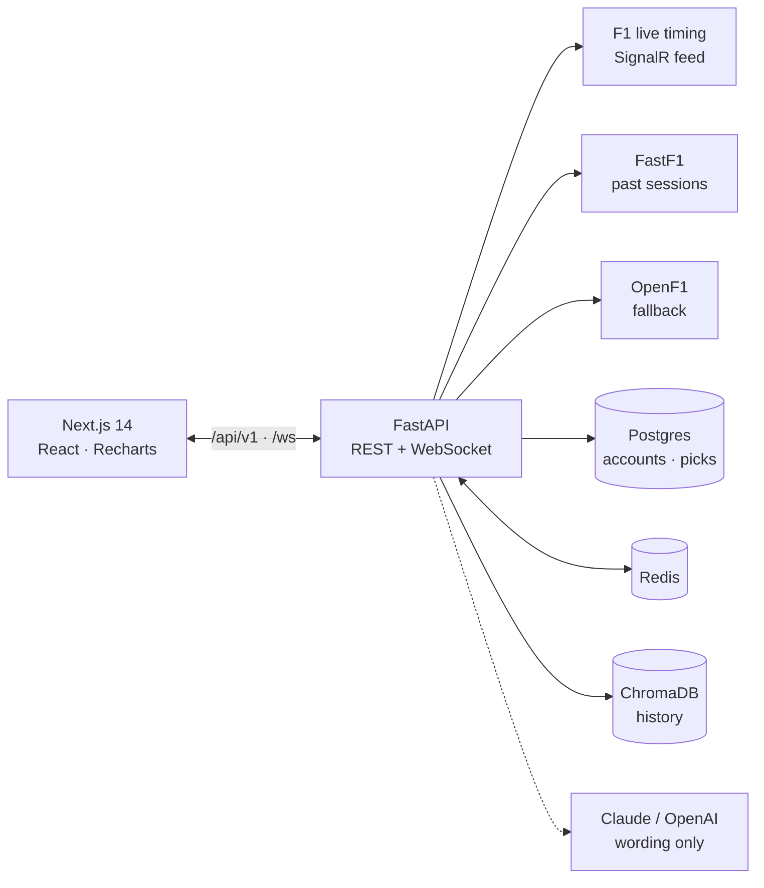

<div align="center">



<br>

[What's in it](#whats-in-it) · [Live](#during-a-race) · [Run it](#running-it) · [How it works](#how-it-works) · [Tests](#tests)

</div>

<br>

Pit Wall is an F1 timing app for people who watch the timing screen more than the TV. It does live timing during a session, and for any race since 2018 you can replay it, compare two drivers' laps, or work out whether a different pit stop would have paid off.

Everything is built on [FastF1](https://github.com/theOehrly/Fast-F1) and F1's own live timing feed. Positions, gaps, tyre models and probabilities are all calculated in plain Python. Where a language model is involved, it only writes sentences around numbers it was given, and the app checks those sentences before showing them.


## What's in it

**Live**

| Page | What it does |
|---|---|
| Live timing | The tower, sectors, tyres and gaps, plus battles and pit stop forecasts during a race (more below). |
| Track map | Every car on the circuit live, or a past race replayed lap by lap on the real clock. |

**Looking back at a session**

| Page | What it does |
|---|---|
| Head to head | Two drivers' fastest laps overlaid: speed, throttle, brake, gear, RPM, DRS, the gap, who won each mini-sector, and a corner-by-corner table. |
| Advanced analytics | Throttle, brake and coasting habits for the whole field, and how consistent each driver is through each corner. |
| Race pace | Fuel-corrected long-run pace, and how quickly each compound wore out. |
| Strategy simulator | Try a tyre strategy against that race's own degradation numbers. |
| Pit window | Pick any lap of a past race and see each driver's best plan from there, when their window opens, and who could undercut whom. |
| Win probability | Every driver's chance of winning, lap by lap, with the reasoning behind any lap you click. |
| Overtakes and battles | Every pass on track, places gained at the start, and every fight inside a second. |
| Race debrief | A written summary of the race, and "what if he'd stopped five laps earlier" on the real strategies. |

**The season**

| Page | What it does |
|---|---|
| Season stats | Driver and constructor standings since 2018. |
| Championship odds | Who can still win the title, from a Monte Carlo run of the races left. |
| Archive | Past seasons, calendars and results. |
| Predictions | Pick the podium before lights out and see how you rank. 25 points for an exact podium, 10 per driver who finishes in the top 3. |
| Ask the data | Ask a question in plain English and get an answer built from the app's own analysis endpoints, with the calls it made listed underneath. Needs an Anthropic key and a signed-in user. |

Every analysis page has its own URL, so you can send someone a link straight to a comparison:

```text
/compare?year=2024&round=14&d1=VER&d2=NOR
/pitwindow?year=2024&round=14&lap=20
/map?year=2024&round=14
```

<br>



<sub>The graphic above uses real data: Verstappen's and Leclerc's best laps from qualifying at Spa in 2024, from the same endpoint the Head to head page calls, replayed at 7x. <code>docs/readme/generate.py</code> rebuilds it.</sub>


## During a race



The live page reads F1's timing feed directly. During a race, the "Battles and pit stops" panel refreshes every few seconds and shows:

- **Battles.** Who is already in DRS range, and who will get there and roughly when. The estimate comes from the live gap and how much the chasing car has gained per lap over its last few clean laps.
- **If they pit now.** Where each car would be after its out-lap, how far it would be from the cars either side, and a traffic warning if it would come out right behind someone.
- **Undercut and overcut.** For each car close behind another, whether stopping first (or staying out longer) would get it past, and by how much.

It was tested by replaying the Singapore 2026 race through it. The battle forecasts mostly came true, and 21 of the 23 real stops came out within one place of the forecast. Behind a safety car it stops forecasting battles and halves the cost of a stop.


## Running it

You need Python 3.12, Node 20+ and Docker (for Postgres and Redis).

```bash
cp .env.example .env
```

Set `SECRET_KEY` in `.env` (`python -c "import secrets; print(secrets.token_hex(32))"` makes one) and `RUNNING_LOCALLY=true` if the backend runs on your machine rather than in Docker. `ANTHROPIC_API_KEY` and `OPENAI_API_KEY` are optional. Without them, the debrief and race engineer use templates and Ask the data is switched off.

```bash
docker compose up -d postgres redis

# backend, http://localhost:8000
cd backend
python -m venv .venv
.venv\Scripts\activate            # macOS/Linux: source .venv/bin/activate
pip install -r requirements.txt
uvicorn app.main:app --port 8000

# frontend, http://localhost:3000
cd frontend
npm install
npm run dev
```

The first time you open a session, FastF1 downloads it, which can take a minute. After that it loads from the cache.

`docker compose up --build -d` runs the whole thing in containers instead. In that case, leave `RUNNING_LOCALLY=false`.

**Race data and live car positions.** F1 now puts its timing archive, older seasons included, and the live car position stream behind an F1 TV login. FastF1 3.9 handles the login:

```bash
python -m fastf1 auth f1tv --authenticate --method browser
```

It prints a link to sign in through your browser, and the token lasts a few days (`python -m fastf1 auth f1tv --status` shows when it expires). Without `--method browser` it asks for your email and password in the terminal instead, which fails where nothing can type into it. Without a token, sessions the backend hasn't already cached won't load, and the track map loses the cars, but live timing still works.


## How it works



The frontend uses Next.js 14, React 18, TypeScript, Tailwind, Recharts, framer-motion, react-grid-layout and Zustand. The backend uses FastAPI, SQLAlchemy, FastF1, pandas, NumPy and LangGraph (for the what-if flow). Data lives in Postgres 16, Redis 7 and ChromaDB.

Accounts use bcrypt, a JWT in an httpOnly cookie, and CSRF protection. Each IP gets 10 login tries per 15 minutes and 5 sign-ups an hour. The routes that spend AI credits are limited too: Ask the data takes 20 questions an hour and needs a signed-in user. The limits are counted in the backend's memory, so run a single worker. There's no email verification or password reset.

<details>
<summary><b>API</b> (everything is under <code>/api/v1</code>; interactive docs at <code>localhost:8000/docs</code>)</summary>

<br>

| Area | Endpoints |
|---|---|
| Live | `GET /sessions/active` · `/sessions/{key}/drivers` · `/timing` · `/status` · `/race-strategy` · `/weather` · `/race-control` · `/radios` · `GET /circuits/{key}/layout` · WebSocket `/ws/{client_id}` |
| Telemetry | `POST /telemetry/compare` · `/pedal-behavior` · `/corner-consistency` · `/race-pace` · `/race-battles` · `/pit-window` · `/win-probability` · `GET /telemetry/replay` |
| Strategy | `POST /strategy/simulate` · `GET /sessions/{key}/strategy` · `POST /championship/odds` |
| Races | `GET /races/historical` · `/races/session-info` · `/races/results` · `/races/latest-result` |
| Writing | `GET /debrief` · `POST /whatif` · `POST /ai/chat` · `POST /ask` |
| Stats | `GET /stats/standings` · `/drivers/known-codes` · `/drivers/{code}/season-insights` · `/share/result-card` |
| Accounts | `POST /auth/signup` · `/auth/login` · `/auth/logout` · `GET /auth/me` |
| Predictions | `POST /predictions` · `GET /predictions/me` · `GET /leaderboard` · `POST /predictions/score` |

</details>

<details>
<summary><b>The look</b></summary>

<br>

It copies the F1 broadcast graphics: dark navy, F1 red, and square corners. Colour is only used when it means something: purple for the fastest overall, green for a personal best, yellow for slower, red for live, plus tyre and team colours. Everything else is grey and white. The type is Titillium Web and Barlow Semi Condensed, both self-hosted. The colour tokens in `frontend/src/design/tokens.css` are tested against WCAG AA contrast.

To add a page, add one entry to `frontend/src/lib/modules.ts`. The sidebar, the mobile tab bar, the command palette and the landing page all read from it.

</details>

<details>
<summary><b>Optional: race history for the race engineer</b></summary>

<br>

With a history corpus, the race engineer can answer questions across seasons, like how Spa strategies have changed over recent years. Without one, it sticks to the live session.

```bash
docker compose up -d chromadb
cd backend
python -m app.scripts.ingest_history --years 2018-2025
```

The first run takes hours because every session is loaded from scratch. You can stop it with Ctrl-C and run it again; sessions that are already done get skipped.

</details>


## Tests

```bash
cd backend && SECRET_KEY=test RUNNING_LOCALLY=true python -m pytest -q
cd frontend && npm test && npm run typecheck && node scripts/check-legacy.mjs --all
```

GitHub Actions runs pytest, tsc, vitest and a production build on every push and pull request.
